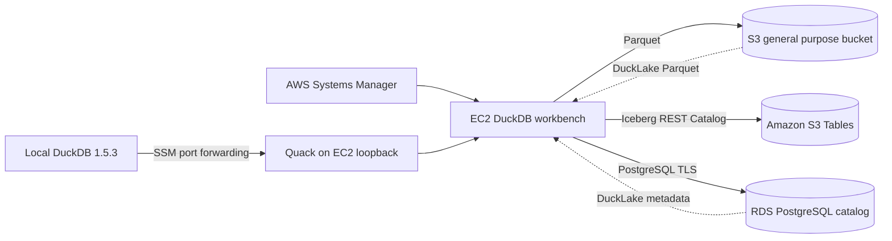

# 架构设计

## 逻辑架构



## 资源职责

| 资源 | 职责 | 不承担的职责 |
|---|---|---|
| EC2 `t3.small` | 运行 DuckDB CLI、DuckLake extension、Iceberg extension、Quack | 不作为 catalog 或对象数据的唯一持久层 |
| S3 general purpose bucket | 保存原始 Parquet、DuckLake Parquet、脚本同步副本 | 不提供 DuckLake 事务语义 |
| S3 Tables | 托管 `demo.events` Iceberg 表及维护 | 不保存 DuckLake catalog |
| RDS PostgreSQL `db.t4g.micro` | 保存 DuckLake 1.0 catalog 与事务元数据 | 不保存分析数据文件 |
| Secrets Manager | 生成并保存 RDS master credential | 不把密码写入仓库或 CloudFormation output |
| Systems Manager | Shell access、Run Command、Quack port forwarding | 不要求开放 SSH 或 Quack security group ingress |

## 网络

- VPC CIDR 为 `10.42.0.0/16`。
- 两个 public subnet 只用于工作台；没有 SSH ingress。
- 两个 isolated subnet 用于 RDS。
- RDS security group 仅允许来自工作台 security group 的 TCP 5432。
- 不创建 NAT Gateway。
- S3 使用 Gateway VPC Endpoint。
- S3 Tables、GitHub extension 下载、Secrets Manager 和 SSM 通过工作台 public IPv4 出站访问。

## 数据路径

### Path A: S3 Parquet

DuckDB 使用 `httpfs` 与 AWS credential chain，直接向固定 S3 URI 写入和查询 Parquet。

### Path B: S3 Tables Iceberg

CloudFormation 创建 table bucket、namespace 和 `events` 表。DuckDB 执行：

```sql
ATTACH '<table-bucket-arn>' AS ice
(TYPE ICEBERG, ENDPOINT_TYPE 'S3_Tables');
```

运行角色只对该 table ARN 拥有数据与 metadata commit 权限。

### Path C: DuckLake

DuckDB 执行：

```sql
ATTACH 'ducklake:postgres:<connection-string>' AS lake
(DATA_PATH 's3://<bucket>/ducklake/');
```

RDS 保存 catalog，S3 保存不可变 Parquet 文件。多个 DuckDB 进程通过同一个 PostgreSQL catalog 协调提交。

### Path D: Quack

远端 DuckDB 会话 ATTACH 了 `ice` 和 `lake`，再调用：

```sql
CALL quack_serve('quack:localhost', token := '<runtime-token>');
```

本地端口 9494 通过 `AWS-StartPortForwardingSession` 转发到 EC2 loopback。Token 只写入工作台上权限为 `0600` 的文件，不进入 Git 或 CloudFormation output。本地客户端会通过 SSM Run Command 读取它，因此拥有 SSM command invocation 读取权限的主体可能在命令历史中看到该 token；这个取舍只适用于隔离的 Demo 环境。

## 基础设施选择

- CDK 使用 L2 构建 VPC、S3、RDS、EC2 和 IAM。
- S3 Tables 使用 CloudFormation L1，因为当前没有稳定 L2。
- `cdk-nag` 在严格 synth 阶段执行。
- RDS 单 AZ、无删除保护、EC2 无详细监控等 Demo 取舍均有资源级确认记录。
- S3 Tables 表纳入 CloudFormation 生命周期，确保销毁顺序为 table、namespace、table bucket。
